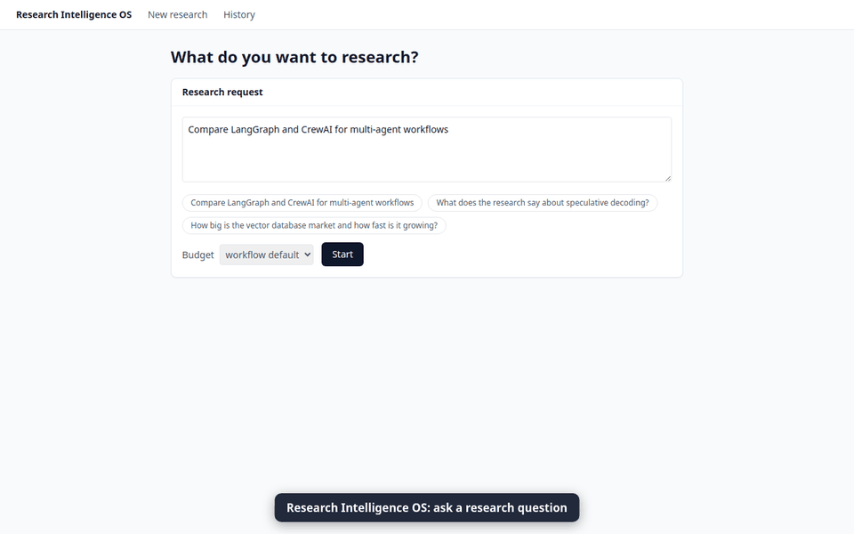
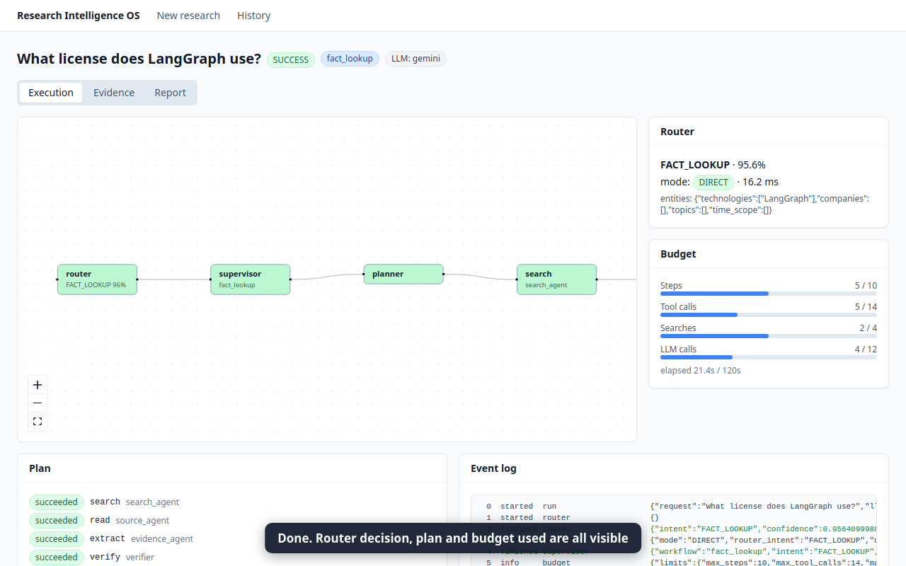
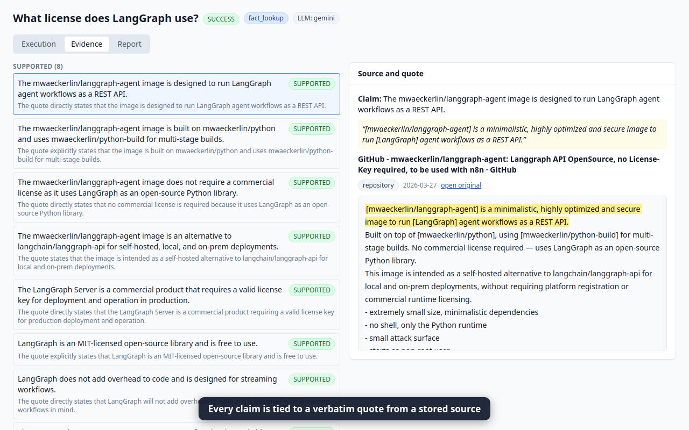
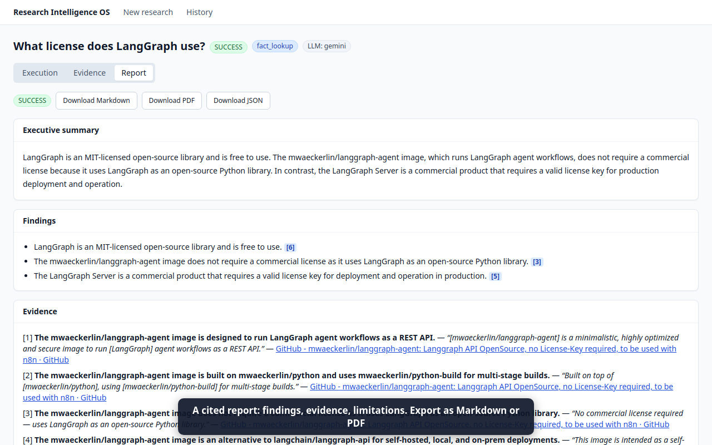
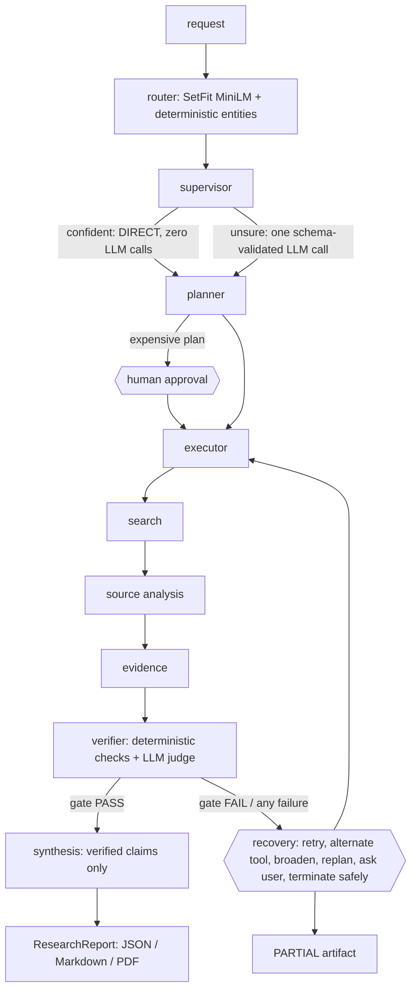

# Research Intelligence OS



  

**The problem.** LLM research tools make things up, and they are slow and costly because every request goes through a large model. This project
answers each request with **claims that must carry a verbatim quote from a stored source**, and it spends LLM calls only where they are needed.

A research system whose control point is a **fine-tuned MiniLM router running on CPU in ~12 ms**. An LLM supervisor and planner turn a request
into a multi-step plan, specialised agents gather and analyse evidence, a **verifier gates what reaches the report**, and a **harness** governs
everything: tool permissions and schemas, budgets, retries, failure recovery, human approval, record/replay, tracing and evaluation.

> Everything the system reports is checked: every finding cites claim ids, every claim cites a source and a **verbatim quote that exists in the
> stored source text**. Claims that are not supported by their quote never appear as findings.

**Run it:** `docker compose up --build`, then open http://localhost:3201 (needs `.env` with `GOOGLE_API_KEY` and `TAVILY_API_KEY`; details in
[Run it with Docker](#run-it-with-docker-one-command)).

## Demo

A real run in the real UI (live Gemini and web sources, started with `docker compose up`): [full recording (webm, 3 MB)](docs/demo/demo.webm). Screenshots:

| Execution graph, router decision, budget | Evidence with highlighted verbatim quote | Cited report |
|---|---|---|
|  |  |  |

Re-record with `cd frontend && node record_demo.mjs && cd .. && python -m scripts.make_demo_gif`.

## What it does



* **Router** (`research_os/router/`): 8 research intents; routing mode `DIRECT` (confident) or `LLM_FALLBACK` (threshold chosen on validation data);
  deterministic entity extraction (gazetteer + regex, no LLM).
* **Supervisor / planner / agents** (`research_os/agents/`): workflow templates per intent (`configs/workflows.yaml`), validated plans with cost
  estimates, five step agents. Prompts are versioned files in `research_os/prompts/`; every LLM output is validated against a Pydantic schema with
  at most 2 retries; models only ever see short ids (`c1`, `s2`), never hashes they could mis-copy.
* **Verifier** (`harness/verification.py`, `agents/verifier.py`): deterministic grounding checks (source exists, quote verbatim, source type, dates,
  comparatives / numbers / universals / causal language must appear in the quote), an LLM judge for entailment, contradiction detection across
  sources, and a PASS/FAIL gate. Conflicts are *surfaced*, not hidden and not fatal.
* **Harness**: enforced tool registry (schemas, permissions, domain policy, SSRF protection, timeouts, retries, output caps), execution budgets
  checked before every step / tool call / LLM call, failure recovery table (`configs/recovery.yaml`), record/replay of every tool and LLM call,
  human-in-the-loop approvals (LangGraph interrupts), persistent memory (SQLAlchemy + Alembic; SQLite default, Postgres verified), Langfuse tracing
  (no-op without keys).
* **API + UI**: FastAPI (`POST /runs`, SSE event stream with resume, reports as JSON / Markdown / PDF, approve / reject) and a Next.js app
  (workspace, live execution graph, evidence explorer with quote highlighting, report with clickable citations, history, approval modal).

## Results

All numbers below are generated from files under `experiments/` by `python -m scripts.render_results`; nothing is typed by hand.

<!-- RESULTS:START -->
### Router: fine-tuned MiniLM vs frozen-embedding baseline

| Model | Test accuracy | Test macro F1 | Hard-set accuracy | Hard-set macro F1 | Independent-set accuracy | Independent-set macro F1 |
|---|---|---|---|---|---|---|
| Frozen MiniLM + LogReg (baseline) | 90.74% | 90.65% | 93.65% | 93.96% | 85.58% | 84.74% |
| SetFit fine-tuned MiniLM | 97.53% | 97.54% | 93.65% | 93.65% | 96.15% | 96.14% |

Test = held-out split of the synthetic data (n=162). Hard set = 63 hand-written ambiguous queries. Independent set = 104 queries written separately from the training pipeline (13 per intent; never used for training or tuning; single labeller, see `data/independent_test_REVIEW.md`).

### Router: data-size ablation (test, mean ± std over 3 seeds)

| Examples / intent | Accuracy | Macro F1 |
|---|---|---|
| 10 | 81.48 ± 1.33 | 80.95 ± 1.13 |
| 25 | 92.39 ± 0.77 | 92.31 ± 0.86 |
| 50 | 94.44 ± 0.87 | 94.44 ± 0.89 |
| 80 | 97.33 ± 0.29 | 97.34 ± 0.29 |

Routing threshold: **0.6** (smallest threshold with covered accuracy >= 1.0 on val).

### Router latency (batch size 1, CPU)

| Model | P50 | P95 | P99 | Throughput | Size on disk | RSS after load | Threads |
|---|---|---|---|---|---|---|---|
| Baseline | 12.7 ms | 15.6 ms | 17.4 ms | 80 req/s | 91.6 MB | 583 MB | 4 |
| SetFit fine-tuned | 11.0 ms | 15.0 ms | 16.1 ms | 88 req/s | 91.6 MB | 570 MB | 4 |

Entity extraction alone: P95 0.69 ms; full `route()` vs classifier-only P95 overhead -0.19 ms (within noise).

_Hardware: 13th Gen Intel(R) Core(TM) i7-1355U, 12 cores, 33.3 GB RAM, torch 2.14.1+cpu._

### Four-system evaluation (A LLM-only, B MiniLM-only, C hybrid, D hybrid + harness)

### Evaluation summary (2026-10-03)

#### How to read this

- 120 tasks, one run per (system, task), **replayed** from frozen sources recorded live; LLM answers come from a content-addressed cache, so reruns are identical. Latency columns are wall-clock/recorded and not part of the determinism guarantee.
- Quality metrics are judged by `gemini-3.5-flash` (a different model from the pipeline's verifier). **Judge agreement vs hand labels: n=60, accuracy=0.85, kappa=0.33.**
- Tasks, intent labels and claim labels were written by the project author. Rates show mean [95% bootstrap CI over tasks]. One live recording, one replay: no run-to-run variance is measured.

#### Router

| System | workflow accuracy | macro F1 | routing P50 | routing P95 | routing P99 |
|---|---|---|---|---|---|
| A | 93.3% | 93.3% | 1339.6 ms | 1490.3 ms | 1938.6 ms |
| B | 85.8% | 86.0% | 329.1 ms | 479.2 ms | 517.4 ms |
| C | 88.3% | 88.4% | 421.1 ms | 1722.5 ms | 1981.2 ms |
| D | 88.3% | 88.4% | 308.4 ms | 1425.4 ms | 1825.9 ms |

#### Research quality

| System | task completion | end-to-end success | unsupported-claim rate | citation correctness | source relevance |
|---|---|---|---|---|---|
| A | 71.7% [63.3%, 80.0%] | 67.5% [59.2%, 76.7%] | 6.0% [3.9%, 8.3%] | 94.0% [91.7%, 96.1%] | 58.7% [52.6%, 64.2%] |
| B | 71.7% [63.3%, 80.0%] | 67.5% [59.2%, 76.7%] | 6.0% [3.9%, 8.6%] | 94.0% [91.4%, 96.1%] | 59.5% [53.6%, 65.0%] |
| C | 71.7% [63.3%, 80.0%] | 67.5% [59.2%, 76.7%] | 6.1% [3.9%, 8.6%] | 93.9% [91.4%, 96.1%] | 58.8% [52.9%, 64.4%] |
| D | 65.8% [57.5%, 74.2%] | 65.0% [56.7%, 73.3%] | 2.4% [1.2%, 3.8%] | 97.6% [96.2%, 98.8%] | 58.0% [52.4%, 63.5%] |

#### Agent system

| System | tool selection | plan success | recovery success | end-to-end |
|---|---|---|---|---|
| A | 98.4% [96.0%, 99.9%] | 100.0% [100.0%, 100.0%] | n/a | 67.5% [59.2%, 76.7%] |
| B | 98.5% [97.1%, 99.6%] | 100.0% [100.0%, 100.0%] | n/a | 67.5% [59.2%, 76.7%] |
| C | 99.3% [98.4%, 100.0%] | 100.0% [100.0%, 100.0%] | n/a | 67.5% [59.2%, 76.7%] |
| D | 99.3% [98.4%, 100.0%] | 76.7% [69.1%, 84.2%] | 3.4% [0.0%, 10.3%] | 65.0% [56.7%, 73.3%] |

#### Efficiency

| System | LLM calls/run | input tok/run | output tok/run | cost/run (USD) | total cost (USD) | tool calls/run | wall P50 | wall P95 |
|---|---|---|---|---|---|---|---|---|
| A | 3.17 [3.10, 3.26] | 2551 | 1393 | $0.00425 | $0.510 | 3.33 [2.91, 3.75] | 0.7 s | 4.4 s |
| B | 2.14 [2.08, 2.21] | 2111 | 1337 | $0.00397 | $0.477 | 3.17 [2.77, 3.58] | 0.7 s | 0.9 s |
| C | 2.22 [2.13, 2.31] | 2154 | 1354 | $0.00403 | $0.484 | 3.17 [2.77, 3.59] | 0.7 s | 1.0 s |
| D | 3.67 [3.47, 3.89] | 3460 | 1887 | $0.00576 | $0.691 | 3.83 [3.30, 4.42] | 1.0 s | 1.6 s |

#### Harness ablations

| System | completion | e2e success | unsupported rate | citation correctness | delta vs D |
|---|---|---|---|---|---|
| D (full harness) | 65.8% [57.5%, 74.2%] | 65.0% [56.7%, 73.3%] | 2.4% [1.2%, 3.8%] | 97.6% [96.2%, 98.8%] | - |
| D-no-verifier | 71.7% [63.3%, 80.0%] | 67.5% [59.2%, 76.7%] | 6.1% [3.9%, 8.6%] | 93.9% [91.4%, 96.1%] | completion +5.8pp, e2e_success +2.5pp, unsupported_rate +3.7pp, citation_correctness -3.7pp |
| D-no-recovery | 65.0% [56.7%, 73.3%] | 64.2% [55.8%, 72.5%] | 2.6% [1.4%, 4.0%] | 97.4% [96.0%, 98.6%] | completion -0.8pp, e2e_success -0.8pp, unsupported_rate +0.2pp, citation_correctness -0.2pp |
| D-no-budgets | 65.8% [57.5%, 74.2%] | 65.0% [56.7%, 73.3%] | 2.6% [1.2%, 4.0%] | 97.4% [96.0%, 98.8%] | completion +0.0pp, e2e_success +0.0pp, unsupported_rate +0.2pp, citation_correctness -0.2pp |

#### By task kind

| System | completion | e2e success | unsupported rate |
|---|---|---|---|
| A / normal | 68.1% | 66.7% | 5.2% |
| A / ambiguous | 75.0% | 66.7% | 6.9% |
| A / tempting | 79.2% | 70.8% | 7.3% |
| B / normal | 68.1% | 65.3% | 5.5% |
| B / ambiguous | 75.0% | 70.8% | 6.9% |
| B / tempting | 79.2% | 70.8% | 6.7% |
| C / normal | 68.1% | 65.3% | 5.7% |
| C / ambiguous | 75.0% | 70.8% | 6.7% |
| C / tempting | 79.2% | 70.8% | 6.7% |
| D / normal | 65.3% | 65.3% | 2.1% |
| D / ambiguous | 75.0% | 75.0% | 2.7% |
| D / tempting | 58.3% | 54.2% | 2.8% |


### Failure injection

### Failure injection

offline: fixture corpus + deterministic demo LLM; D = full harness, C = minimal harness (contrast)

| System | expectations met | crash rate | recovery success | safe termination |
|---|---|---|---|---|
| D | 100% | 0% | 100% (5) | 100% (3) |
| C | 27% | 0% | 0% (5) | 0% (3) |

| Scenario | Failure type | D | C |
|---|---|---|---|
| search_api_timeout | SEARCH_TIMEOUT | met (SUCCESS) | NOT met (FAILED) |
| invalid_urls | INVALID_SOURCE | met (SUCCESS) | met (SUCCESS) |
| no_sources_found | NO_USEFUL_SOURCES | met (PARTIAL) | NOT met (FAILED) |
| contradictory_sources | CONFLICTING_EVIDENCE | met (SUCCESS) | NOT met (SUCCESS) |
| malformed_tool_arguments | TOOL_FAILURE | met (SUCCESS) | met (SUCCESS) |
| llm_unsupported_claim | UNSUPPORTED_CLAIM | met (SUCCESS) | NOT met (SUCCESS) |
| tool_returns_garbage | INVALID_SOURCE/garbage | met (PARTIAL) | NOT met (SUCCESS) |
| impossible_plan | IMPOSSIBLE_PLAN | met (SUCCESS) | NOT met (PARTIAL) |
| budget_exceeded | BUDGET_EXHAUSTED | met (PARTIAL) | NOT met (SUCCESS) |
| prompt_injection_in_source | PROMPT_INJECTION | met (SUCCESS) | met (SUCCESS) |
| llm_malformed_output | MALFORMED_LLM_OUTPUT | met (SUCCESS) | NOT met (PARTIAL) |


### Verifier gold set

30 pairs hand-written by the project author, judged by `gemini-2.5-flash`: accuracy 100.0% (a regression test and upper bound, not an unbiased estimate; see `experiments/results/verifier_eval_NOTES.md`).
<!-- RESULTS:END -->

## Run it with Docker (one command)

```bash
# needs ./.env with GOOGLE_API_KEY and TAVILY_API_KEY, and the trained router in ./models/router
docker compose up --build        # then open http://localhost:3201   (API: http://localhost:8010/docs)
```

Ports are `UI_PORT` / `API_PORT` (defaults 3201 / 8010). Run history lives in the `research-os_runs` volume; `docker compose down` keeps it,
`docker compose down -v` deletes it.

## Setup

```bash
uv venv .venv && uv pip install --python .venv/bin/python --index-strategy unsafe-best-match -r requirements.txt
cp .env.example .env     # GOOGLE_API_KEY (Gemini), TAVILY_API_KEY (web search); optional GITHUB_TOKEN, LANGFUSE_*, DATABASE_URL
make data && make train  # research-domain router (synthetic data; models/ is git-ignored, ~1 hour of CPU for the grid + final model)
make api                 # FastAPI on :8000 (offline demo LLM unless GOOGLE_API_KEY is set)
make ui                  # Next.js on :3000 (needs Node 18+)
```

| Command | What it does |
|---|---|
| `make test` | unit + integration tests (offline, no network, no keys) |
| `make eval-router` | baseline vs fine-tuned router, latency benchmark -> `experiments/router/` |
| `make eval` | replay all tasks on systems A-D and the harness ablations, judge, write `experiments/results/summary.{json,md}` |
| `make eval-faults` | failure-injection suite (offline) |
| `make eval-record` | **live** recording of the frozen evaluation corpus (costs API calls) |
| `make eval-baseline-m6` | the original healthcare-domain baseline (`baseline-m6` tag) |
| `python -m scripts.smoke_tools` | live smoke test of each tool (skips tools whose key is missing) |
| `cd frontend && npm run build:e2e && npx playwright test` | UI smoke tests (isolated ports 8765 / 3101) |

## Design decisions

* **Why a small router at all?** The expensive thing is the LLM; the router answers one narrow question in ~11 ms on CPU and lets the supervisor skip
  the LLM entirely when it is confident. `DIRECT` mode makes zero LLM calls, so "LLM calls saved" is measurable.
* **Why a verifier gate?** Plausible-sounding unsupported claims are the failure mode that matters for research. The gate is deterministic first
  (cheap, auditable) and only then asks an LLM judge; the judge cannot upgrade a deterministic rejection.
* **Why record/replay?** The web drifts and LLMs are non-deterministic. Evaluation replays a frozen per-task source corpus and a content-addressed LLM
  cache, so a rerun is identical and free.
* **Why not more agents / frameworks / vector DBs?** `docs/archive/ROADMAP2.md` section 9: LangGraph only, five step agents, brute-force cosine over MiniLM embeddings.

## Limitations (please read)

* **Router data is synthetic** (templates + LLM-generated, reviewed by the author). On the in-distribution test split the fine-tuned router beats
  the frozen-embedding baseline (97.5% vs 90.7%) and on the independent hand-written set (96.2% vs 85.6%), but on the 63-row hard set the two are
  **tied** (93.65%). On the 120 evaluation tasks (which include ambiguous and deliberately tempting requests) routing accuracy is lower: 85.8% for the
  MiniLM-only system and 88.3% for the hybrid, against 93.3% for an LLM-only router (which costs about 1.3 s and a paid call per request).
* **Evaluation tasks, intent labels, gold claim labels and the independent router set were written by one person** (the project author and the AI
  assistant that helped build it), not independent annotators. The quality metrics use an LLM judge; its agreement with the hand labels is **modest**
  (accuracy 0.85, Cohen's kappa 0.33 on 60 claims), so judged numbers are suggestive, not firm. Citation correctness equals 1 - unsupported rate on every
  system, so it is one judged quantity, not two.
* **The recorded evaluation predates a few fixes** (see below). Replay is not the live web: sources were recorded once (see
  `evaluation/cassettes/RECORDING.json`). One live recording and one replay, so no run-to-run variance is measured.
* **Recovery is weak on real tasks.** In the failure-injection suite (offline, synthetic corpus) the full harness meets its expectation in all 11
  scenarios, but on the 120 real tasks recovery rescued only about 3% of failed runs, and the full harness completes fewer tasks (65.8%) than the minimal
  one (71.7%) in exchange for a lower unsupported-claim rate (2.4% vs 6%).
* **Live web results vary.** Source relevance was about 58% in the evaluation. Embedding-based passage scoring separated on-topic from off-topic
  passages only weakly on a 20-question dev set (AUC about 0.70), so it was **not** shipped (`evaluation/dev_relevance.py` keeps the experiment).
* **Voice** was demonstrated end to end with a bot caller speaking synthesized audio through a real LiveKit server (`docs/VOICE.md`); real
  microphones, accents and noise are untested. Langfuse tracing was verified against a self-hosted Langfuse 4.49 only (not Langfuse Cloud).
* The demo LLM (`llm/demo_client.py`) is extractive and exists for the UI / CI; it is never used for evaluation numbers.
* Latency is measured on one machine; wall-clock fields are excluded from the determinism guarantee.
* Gemini is the only LLM provider implemented; prices in `configs/eval.yaml` are configurable placeholders, not authoritative.

### Fixed after the evaluation was recorded (results above do not include these)

* **False conflicts removed good answers.** The conflict detector flagged claims from the *same* source and claims about different products. It now
  requires two different sources and one LLM confirmation call per run with candidates (`prompts/conflict_confirm.v2.md`: it must name each side's subject first, and different subjects never conflict). A live run of "What
  license does LangGraph use?" had answered with an unrelated claim because the correct one was marked contradicted; it now answers correctly.
* Numbers in a report summary or finding must appear in the claims they cite (retry, then fail the step).
* `fetch_url` connects to the IP that passed the SSRF check (closes a DNS-rebinding window), and ignores proxy environment variables.
* Source URLs must be http(s) (a `javascript:` link could have reached the UI); comparison and deep-dive workflows accept a GitHub README as
  primary documentation; a finished run's elapsed time no longer keeps growing.

## Repository layout

```
research_os/   router/ llm/ tools/ agents/ harness/ graph/ memory/ artifacts/ observability/ api/ voice/  (+ legacy/: the original healthcare demo)
evaluation/    dataset/ cassettes/ runner.py metrics.py judges.py replay.py systems.py failure_injection.py report_results.py
experiments/   router/ (router results)  results/ (evaluation results)  baseline_results.json (M6.1)
configs/       intents, routing, workflows, budgets, tools, models, recovery, memory, eval, agents, tracing, api (+ healthcare/)
frontend/      Next.js app + Playwright smoke tests
docs/          ARCHITECTURE.md  WALKTHROUGH.md  OBSERVABILITY.md  VOICE.md  MIGRATION.md  PDF_SPIKE.md  archive/ (old roadmaps and results)
docker/        langfuse/ (self-hosted tracing stack)      Dockerfile  docker-compose.yml  (one-command app)
```

History: milestones are tagged `m<n>-done` (`baseline-m6` marks the healthcare baseline). `docs/archive/ROADMAP.md` is the original healthcare
router plan; `docs/archive/ROADMAP2.md` is this system's spec; `docs/archive/old_results/` holds early router experiment outputs.
