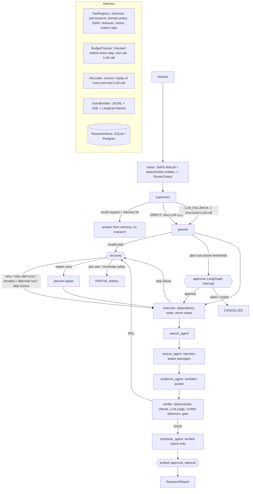

# Architecture

Status: **all milestones M6.0-M24 implemented** (see the verification notes in README "Limitations"). Spec: `docs/archive/ROADMAP2.md`.
Layout map from the original repo: `docs/MIGRATION.md`.

## Run graph

## Components

| Piece | Where | Notes |
|---|---|---|
| Router | `research_os/router/` | SetFit MiniLM; threshold from a validation sweep; `RouterOutput` with entities; ~11 ms P50 on CPU |
| Supervisor | `agents/supervisor.py` | DIRECT = deterministic template; LLM_FALLBACK = schema-validated call, falls back to `general_research`; recall via `memory_search` |
| Planner | `agents/planner.py` | per-entity template instantiation, cycle/tool/budget validation, cost estimate, optional bounded LLM refinement, replan |
| Agents | `agents/` | search, source, evidence, verifier, synthesis; prompts in `research_os/prompts/` (versioned) |
| Harness | `harness/`, `tools/` | enforced registry, budgets, recovery, approvals, record/replay, faults, verification |
| Memory | `memory/` | SQLAlchemy models + Alembic; `memory_search`, prior findings (age, verdict, source and quote still present), monitoring diff |
| Artifacts | `artifacts/` | canonical `ResearchReport` (citation integrity enforced), Markdown (Jinja2), PDF (WeasyPrint) |
| Observability | `observability/` | Langfuse event listener; no-op without keys |
| API | `api/` | FastAPI: runs, SSE with resume, reports, source text, approve / reject |
| UI | `frontend/` | Next.js, Tailwind, React Flow; types generated from OpenAPI |
| Evaluation | `evaluation/` | 120 tasks, frozen corpus, systems A-D + ablations, judges with agreement, failure injection |
| Voice | `voice/` | text adapters + spoken summary; LiveKit guard only |

## LLM backends

Gemini (roles in `configs/models.yaml`; `eval_judge` is a different model from `verifier_judge`) or the offline **demo** LLM (UI / CI only).
Runs record `llm_backend`; limitations in every report say when the demo LLM was used.
